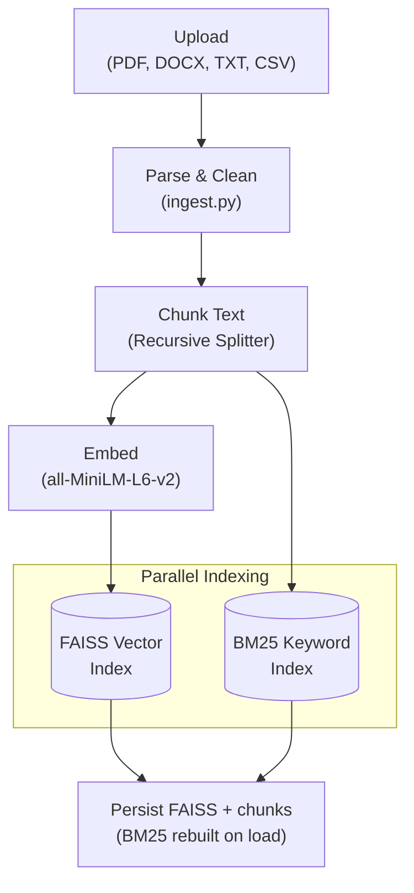
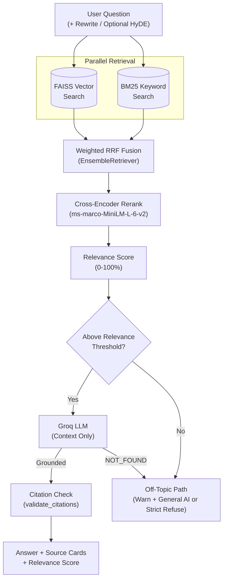

# ⚡ VeriDoc AI — Hybrid RAG Document Q&A Engine

Upload PDF, Word, text, or CSV documents and get fast, source-cited answers backed by hybrid vector + keyword retrieval, Cross-Encoder re-ranking, and relevance-score gating.

[](#run-it-yourself)
[](LICENSE)
[](https://streamlit.io)
[](https://veridoc-rag-ahemad.streamlit.app/)

---

## Live Demo

🚀 **[veridoc-rag-ahemad.streamlit.app](https://veridoc-rag-ahemad.streamlit.app/)**

> *Free Streamlit apps sleep when idle. If you see a "wake up" button, click it and wait ~30 seconds.*

<!-- Record docs/demo.gif — ask a question, show the answer, source cards, and relevance score -->


---

## Why I Built This

Reading through 50–100 page technical specs, legal notes, or company policies to verify a single rule is slow, while pasting large files straight into a chat assistant often misses exact terms, mixes unrelated sections, or invents references.

VeriDoc AI combines meaning-based search with exact keyword search, re-scores candidate passages using a cross-encoder relevance score, blocks low-relevance matches from polluting the answer, and checks cited chunk identifiers against what was actually retrieved before showing sources.

---

## Architecture

### Ingestion (runs once per upload)



Uploads are parsed per file in `ingest.py`, scrubbed of temporary paths, and split into overlapping text chunks. Already-indexed filenames are skipped to avoid duplicate chunks, and new chunks are appended incrementally to the `FAISS` vector store while the `BM25` keyword retriever is rebuilt in memory. Both the `FAISS` index and serialized document chunks are persisted per session in `storage.py`, and `BM25` is rebuilt from those chunks on reload.

### Query (runs on every question)



Every question can be rewritten from recent conversation history and optionally expanded via `HyDE` before running `FAISS` and `BM25` in parallel. Results are merged through `EnsembleRetriever` and re-scored by the MS-MARCO Cross-Encoder into a `0–100%` relevance score. Queries whose chunks fall below the threshold—or whose grounded LLM pass returns `NOT_FOUND`—route to the off-topic path (refuse in Strict Mode, or warn and stream a general AI reply), while grounded answers pass through `validate_citations`.

---

## Key Features

- **Supported Document Formats:** Parses `.pdf` (`PyPDFLoader`), `.docx` (`Docx2txtLoader`), `.txt` (`TextLoader`, UTF-8), and `.csv` (`CSVLoader`), plus a 1-click **Load Demo Enterprise Doc** (`ACME_Enterprise_Arch_2026.pdf`). *(Excel `.xlsx`/`.xls` and legacy `.doc` files are not supported.)*
- **Hybrid Search + Custom BM25:** Pairs L2-normalized `FAISS` vectors with a case- and punctuation-insensitive `BM25` word tokenizer.
- **Cross-Encoder Relevance Gate & Source Cards:** Converts raw MS-MARCO logits to a `0–100%` relevance score, filters out low-scoring distractors, HTML-escapes snippets, and verifies inline citations.
- **Strict Mode & Off-Topic Fallback:** Refuses off-topic questions when **Strict Document-Only Mode** is enabled, or explicitly warns the user before streaming a general AI answer.
- **Session Persistence & Management:** Saves `FAISS` indexes, chunks, metadata, and chat history per session ID (`?sid=`), supports per-document deletion, and exports transcripts to Markdown.
- **Inspection & Eval Views:** Includes a **Retrieval Inspector** (side-by-side BM25 vs. FAISS vs. Cross-Encoder rankings) and an **Accuracy & Eval** smoke-test runner.

---

## Tech Stack

| Layer | Choice | Why |
| :--- | :--- | :--- |
| **UI & Hosting** | Streamlit (`>=1.38.0`) | Interactive sidebar controls, streaming fallback, and free cloud hosting |
| **Orchestration** | LangChain (`core`, `community`, `classic`, `text-splitters`) | Standard loaders, text splitters, and `EnsembleRetriever` |
| **Document Parsing** | `pypdf`, `docx2txt`, `CSVLoader`, `TextLoader` | Lightweight text extraction for `.pdf`, `.docx`, `.csv`, and `.txt` |
| **Embeddings** | HuggingFace `all-MiniLM-L6-v2` | Fast local embeddings with unit-norm cosine similarity behavior |
| **Vector & Sparse Stores** | `faiss-cpu` + `rank-bm25` | Local semantic similarity search paired with exact keyword matching |
| **Re-Ranker** | `cross-encoder/ms-marco-MiniLM-L-6-v2` | Joint `(query, chunk)` scoring for higher precision than bi-encoders alone |
| **LLM Inference** | Groq (`ChatGroq`) | Low-latency LPU inference with selectable models and `<think>` tag stripping |
| **Persistence** | `FAISS.save_local` + JSON | Zero-infrastructure session-namespaced storage on local disk |

---

## Design Decisions

- **Why hybrid search (`FAISS` + `BM25`):** Dense embeddings (`all-MiniLM-L6-v2`, `normalize_embeddings=True`) match paraphrases and synonyms, while `BM25` tokenized via `re.findall(r"\w+", text.lower())` catches exact tokens like `PKCE`, `TLS 1.3`, or `99.99%` regardless of casing or punctuation.
- **Why a two-stage re-ranker:** First-stage retrieval pulls `top_k` candidates per retriever (`2–12`, default `6`), then `cross-encoder/ms-marco-MiniLM-L-6-v2` jointly scores those fused candidates and keeps the top `context_k` chunks (`1–8`, default `4`).
- **How fusion works:** `EnsembleRetriever` combines `BM25` and `FAISS` using weighted Reciprocal Rank Fusion (RRF) controlled by `dense_weight` (`0.0–1.0`, default `0.5`).
- **How the relevance score is computed:** The `0–100%` relevance score is a `sigmoid` of raw Cross-Encoder logits (`1 / (1 + exp(-logit))`), not a calibrated probability; the default cutoff (`25%` / `0.25`, tunable `5%–80%`) was tuned empirically in `app.py` and `eval_suite.py` rather than via a statistical calibration script.
- **Chunking choices:** Uploaded files use `RecursiveCharacterTextSplitter` with `chunk_size=750`, `chunk_overlap=150`, and `["\n\n", "\n", " ", ""]` separators (`420` / `50` for the shorter built-in demo doc), while follow-up rewrites use the last `4` chat turns (capped at `250` chars each).
- **Why Groq:** `ChatGroq` delivers fast inference across `qwen/qwen3.8-27b` (default), `openai/gpt-oss-120b`, and `openai/gpt-oss-20b` at default `temperature=0.1` (`0.0–0.7`), with `<think>...</think>` blocks stripped cleanly.
- **How citations are verified:** `validate_citations` extracts chunk IDs with `r"ID:\s*([^\],\n]+)"` from `[Source: ..., ID: ...]` tags and flags any ID not present in the retrieved chunk set.

---

## 7-Case Smoke Test

Evaluated on `ACME_Enterprise_Arch_2026.pdf` via `eval_suite.py` using `qwen/qwen3.8-27b` (`temperature=0.0` for evaluation and judging):

- **Dataset split:** **5 In-Domain** technical questions + **2 Off-Topic** questions.
- **Judge & fallback behavior:** The same selected `ChatGroq` model (`qwen/qwen3.8-27b`) acts as LLM-as-a-Judge for faithfulness and correctness. `eval_suite.py` does not track a fallback counter in code when JSON parsing fails (silently defaulting to `80.0`), though across the 5 in-domain cases in this run **0/5** scores were `80%` (faithfulness scored `100%` on all 5; correctness scored `100%, 100%, 50%, 60%, 33%`).
- **How each metric is scored:**
  - **Hit Rate@K & MRR:** Case-insensitive **string match** checking whether `expected_keyword` appears in `doc.page_content` of the top reranked chunks.
  - **Faithfulness & Answer Correctness:** **LLM-as-a-Judge** scoring `0–100` in JSON (`faithfulness` vs. retrieved context; `correctness` vs. `expected_answer`).
  - **Off-Topic Rejection:** Passes if top Cross-Encoder relevance score is below threshold, or if the LLM outputs the `NOT_FOUND` sentinel.

| Metric | Score | Notes |
| :--- | :---: | :--- |
| **Retrieval Hit Rate@K** | **100.0%** | 5/5 in-domain queries matched `expected_keyword` at **Rank #1** |
| **Mean Reciprocal Rank (MRR)** | **1.00** | Top-ranked chunk hit on every in-domain case |
| **Faithfulness** | **100.0%** | Judge found zero unsupported claims across all 5 in-domain answers |
| **Off-Topic Rejection** | **100.0%** | 2/2 off-topic queries scored `0.0%` relevance and triggered fallback |
| **Answer Correctness** | **68.6%** | Lower because `expected_answer` bundles extra section facts while the generator prompt asks to be concise |

> *Note: This 7-case suite is a lightweight smoke test, not a full benchmark; a larger multi-document evaluation set is on the roadmap.*

---

## Project Structure

- `app.py` — Streamlit UI, sidebar controls, session initialization, query routing, and views
- `ingest.py` — Multi-format parsing (`.pdf`, `.docx`, `.txt`, `.csv`), chunking, deduplication, and demo doc
- `retrieval.py` — Normalized `FAISS` + regex `BM25`, `EnsembleRetriever` fusion, sigmoid Cross-Encoder reranking, and citation checks
- `storage.py` — Session-namespaced disk persistence (`.veridoc_storage/<sid>/`) and cleanup helpers
- `eval_suite.py` — 7-case retrieval, LLM-as-a-Judge faithfulness/correctness, and off-topic rejection smoke test
- `requirements.txt` — Python package dependencies
- `.env.example` — Environment variable template (`GROQ_API_KEY`)

---

## Run It Yourself

Tested locally on **Python 3.13.9** (and **Python 3.14.10** on Streamlit Community Cloud).

```bash
git clone https://github.com/ahemadraza31/veridoc-hybrid-rag.git
cd veridoc-hybrid-rag
pip install -r requirements.txt
cp .env.example .env
```

Edit `.env` and add your Groq API key, then start the app:

```bash
streamlit run app.py
```

---

## Limitations

- **No OCR for scanned PDFs:** `PyPDFLoader` only extracts embedded text; image-only PDFs return a warning and are skipped.
- **Unsupported formats:** `.xlsx`/`.xls` spreadsheets and legacy `.doc` files are not accepted by the uploader.
- **Grounded answers are non-streaming:** General AI fallback replies stream via `st.write_stream`, whereas grounded RAG answers currently wait for a full `.invoke()` call so `NOT_FOUND` and citations can be checked first.
- **Local session-based disk persistence:** `.veridoc_storage/<sid>/` works locally (`allow_dangerous_deserialization=True` assumes trusted local disk), while free-tier cloud containers wipe local disk on reboot.
- **Free-tier API & retrieval bounds:** Subject to Groq API rate limits, and each query sends only the top `context_k` chunks to the LLM.

---

## Roadmap

- [ ] Expand `eval_suite.py` into a larger multi-document, multi-hop evaluation dataset
- [ ] Add OCR / vision-model ingestion for scanned PDFs and complex tables
- [ ] Add `.xlsx` / `.xls` spreadsheet ingestion support
- [ ] Stream grounded RAG answers while preserving post-response citation validation
- [ ] Add optional managed vector database backend (e.g., Qdrant / pgvector) for multi-user cloud persistence

---

## License

MIT License — see [LICENSE](LICENSE).
