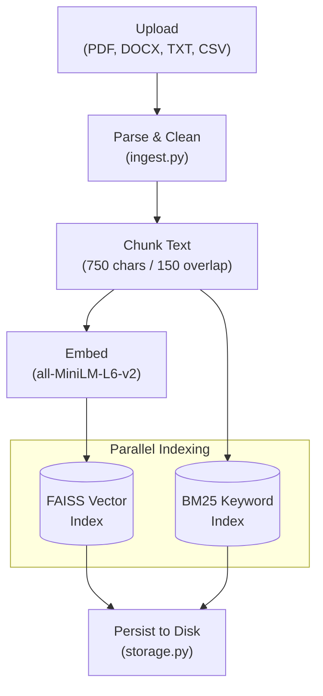
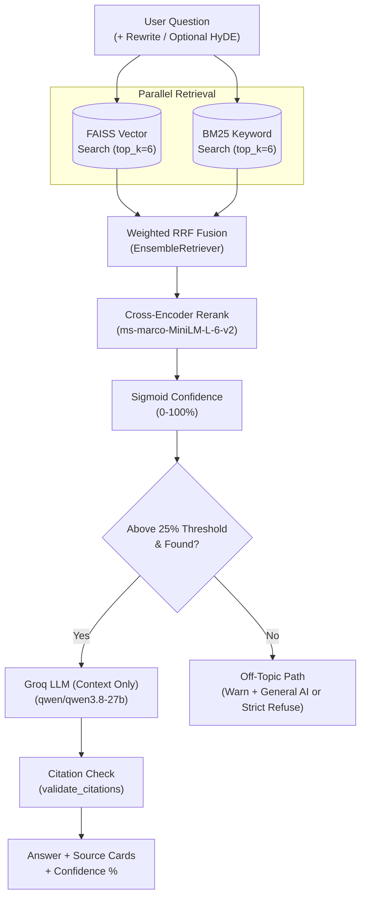

# ⚡ VeriDoc AI — Hybrid RAG Document Q&A Engine

Upload PDF, Word, text, or CSV documents and get fast, source-cited answers backed by hybrid vector + keyword retrieval, Cross-Encoder re-ranking, and confidence gating.

[](#run-it-yourself)
[](LICENSE)
[](https://streamlit.io)
[](https://veridoc-rag-ahemad.streamlit.app/)

---

## Live Demo

🚀 **[veridoc-rag-ahemad.streamlit.app](https://veridoc-rag-ahemad.streamlit.app/)**

> *Free Streamlit apps sleep when idle. If you see a "wake up" button, click it and wait ~30 seconds.*

<!-- TODO: Record docs/demo.gif — ask a question, show the answer, source cards, and confidence score -->


---

## Why I Built This

Reading through 50–100 page technical specs, legal notes, or company policies to verify one rule is slow, while pasting large files straight into a chat LLM risks missed exact terms, unverified claims, and fabricated references.

**VeriDoc AI** pairs dense semantic search (`FAISS`) with exact lexical search (`BM25`), re-scores candidates with an MS-MARCO Cross-Encoder converted to `0–100%` confidence probabilities, enforces a relevance gate (`NOT_FOUND` sentinel + optional Strict Mode), and validates cited chunk IDs before displaying sources.

---

## Architecture

### Ingestion (runs once per upload)



Uploads are parsed per file in `ingest.py`, scrubbed of temporary paths, and split with `RecursiveCharacterTextSplitter` (`chunk_size=750`, `chunk_overlap=150`; the built-in sample doc uses `420` / `50`). Already-indexed filenames are skipped to avoid duplicate chunks, and new chunks are appended incrementally to the L2-normalized `all-MiniLM-L6-v2` `FAISS` store while the regex-tokenized `BM25` retriever is rebuilt in memory. Both the `FAISS` index and serialized chunks are saved per session under `.veridoc_storage/<session_id>/` in `storage.py`.

### Query (runs on every question)



Every question is optionally rewritten from the last 4 chat turns (`rewrite_followup_query`) and optionally expanded via `HyDE` before running `FAISS` and `BM25` in parallel (`top_k=6` by default, tunable `2–12`). Results are fused via `EnsembleRetriever` (weighted RRF, default `0.5` dense / `0.5` sparse) and re-scored by `cross-encoder/ms-marco-MiniLM-L-6-v2`, converting raw logits into `0–100%` probabilities via `sigmoid`. Chunks below the confidence threshold (`25%` default) or answers returning the `NOT_FOUND` sentinel route to the off-topic path (refuse in Strict Mode, or show a warning and stream a general Groq reply), while valid answers pass through `validate_citations` to verify cited chunk IDs.

---

## Key Features

- **Supported Document Formats:** Parses `.pdf` (`PyPDFLoader`), `.docx` (`Docx2txtLoader`), `.txt` (`TextLoader`, UTF-8), and `.csv` (`CSVLoader`), plus a 1-click **Load Demo Enterprise Doc** (`ACME_Enterprise_Arch_2026.pdf`). *(Excel `.xlsx`/`.xls` and legacy `.doc` files are not supported.)*
- **Hybrid Search + Custom BM25:** Pairs L2-normalized `FAISS` vectors with a case- and punctuation-insensitive regex `BM25` tokenizer (`re.findall(r"\w+", text.lower())`).
- **Cross-Encoder Confidence Gate & Source Cards:** Converts MS-MARCO logits to `0–100%` probabilities, filters out low-confidence distractors, HTML-escapes snippets, and validates `[Source, ID]` citations.
- **Strict Mode & Off-Topic Fallback:** Refuses off-topic questions when **Strict Document-Only Mode** is enabled, or explicitly warns the user before streaming a general AI answer.
- **Session Persistence & Management:** Saves indexes, metadata, and chat history to disk per session ID (`?sid=`), supports per-document deletion, and exports transcripts to Markdown.
- **Inspection & Eval Views:** Includes a **Retrieval Inspector** (side-by-side BM25 vs. FAISS vs. Cross-Encoder rankings) and an **Accuracy & Eval** benchmark runner.

---

## Tech Stack

| Layer | Choice | Why |
| :--- | :--- | :--- |
| **UI & Hosting** | Streamlit (`>=1.38.0`) | Fast interactive sidebar controls, streaming fallback, and free cloud hosting |
| **Orchestration** | LangChain (`core`, `community`, `classic`, `text-splitters`) | Standard loaders, `RecursiveCharacterTextSplitter`, and `EnsembleRetriever` |
| **Document Parsing** | `pypdf`, `docx2txt`, `CSVLoader`, `TextLoader` | Lightweight text extraction for `.pdf`, `.docx`, `.csv`, and `.txt` |
| **Embeddings** | HuggingFace `all-MiniLM-L6-v2` (normalized) | Fast, free local 384-dim embeddings with unit-norm cosine behavior |
| **Vector & Sparse Stores** | `faiss-cpu` + `rank-bm25` | Local semantic similarity search paired with exact keyword matching |
| **Re-Ranker** | `cross-encoder/ms-marco-MiniLM-L-6-v2` | Joint `(query, chunk)` scoring for higher precision than bi-encoders alone |
| **LLM Inference** | Groq (`qwen/qwen3.8-27b`, `openai/gpt-oss-120b`, `openai/gpt-oss-20b`) | Low-latency LPU inference with selectable models and `<think>` tag stripping |
| **Persistence** | `FAISS.save_local` + JSON | Zero-infrastructure session-namespaced storage on local disk |

---

## Design Decisions

- **Why hybrid search (`FAISS` + `BM25`):** Dense embeddings match meaning (synonyms/paraphrases) while `BM25` with `re.findall(r"\w+", text.lower())` catches exact tokens like `PKCE`, `TLS 1.3`, or `99.99%` regardless of casing or punctuation.
- **Why a two-stage re-ranker:** A bi-encoder (`all-MiniLM-L6-v2`) searches all chunks quickly, then `cross-encoder/ms-marco-MiniLM-L-6-v2` jointly scores only the retrieved `EnsembleRetriever` candidates (`top_k` default `6`, `context_k` default `4`).
- **How fusion works:** `EnsembleRetriever` merges the `BM25` and `FAISS` ranked lists using weighted Reciprocal Rank Fusion (RRF) controlled by the sidebar `dense_weight` slider (default `0.5` / `0.5`).
- **How confidence is computed:** Raw Cross-Encoder logits are mapped to `[0, 1]` with a numerically stable `sigmoid(logit)` (`1 / (1 + exp(-logit))`) and filtered against `confidence_threshold` (default `25%`, tunable `5%–80%`).
- **Chunking choices:** Uploaded files split at `chunk_size=750` and `chunk_overlap=150` using `["\n\n", "\n", " ", ""]` separators to preserve paragraph boundaries (`420` / `50` for the shorter built-in demo doc).
- **Why Groq:** `ChatGroq` provides low-latency generation across `qwen/qwen3.8-27b`, `openai/gpt-oss-120b`, and `openai/gpt-oss-20b` at default `temperature=0.1` (`TODO: confirm` exact per-model context window limits).
- **How citations are verified:** `validate_citations` extracts chunk IDs via regex (`r"ID:\s*([^\],\n]+)"`) from `[Source: ..., ID: ...]` tags and checks each ID against the actually retrieved chunks.

---

## 7-Case Smoke Test

Evaluated on the built-in `ACME_Enterprise_Arch_2026.pdf` sample document (`eval_suite.py`, `qwen/qwen3.8-27b`, `dense_weight=0.5`, `top_k=6`, `context_k=4`, `confidence_threshold=0.25`):

- **Dataset split:** **5 In-Domain** technical questions + **2 Off-Topic** questions.
- **How each metric is scored:**
  - **Hit Rate@K & MRR:** Deterministic case-insensitive **string match** checking whether `expected_keyword` appears in `doc.page_content` of the top `4` reranked chunks.
  - **Faithfulness & Answer Correctness:** **LLM-as-a-Judge** (`ChatGroq`, `temperature=0.0`) returning `0–100` JSON scores (`faithfulness` vs. retrieved context; `correctness` vs. `expected_answer`, defaulting to `80.0` if JSON parsing fails).
  - **Off-Topic Rejection:** Passes if top Cross-Encoder probability `< 0.25`, or if the LLM returns the `NOT_FOUND` sentinel.

| Metric | Score | Notes |
| :--- | :---: | :--- |
| **Retrieval Hit Rate@K** | **100.0%** | 5/5 in-domain queries matched `expected_keyword` at **Rank #1** |
| **Mean Reciprocal Rank (MRR)** | **1.00** | Top-ranked chunk hit on every in-domain case |
| **Faithfulness** | **100.0%** | Judge found zero unsupported claims across all 5 in-domain answers |
| **Off-Topic Rejection** | **100.0%** | 2/2 off-topic queries scored `0.0%` Cross-Encoder confidence |
| **Answer Correctness** | **68.6%** | Graded strictly against multi-fact reference strings while the generator prompt asks for concise answers |

> *Note: This 7-case suite is a lightweight smoke test, not a full benchmark; a larger multi-document evaluation set is on the roadmap.*

---

## Project Structure

- `app.py` — Streamlit UI, sidebar controls, session initialization, query routing, and views
- `ingest.py` — Multi-format parsing (`.pdf`, `.docx`, `.txt`, `.csv`), chunking, deduplication, and demo doc
- `retrieval.py` — Normalized `FAISS` + regex `BM25`, `EnsembleRetriever` fusion, sigmoid Cross-Encoder reranking, and citation checks
- `storage.py` — Session-namespaced disk persistence (`.veridoc_storage/<sid>/`) and cleanup helpers
- `eval_suite.py` — 7-case retrieval, LLM-as-a-Judge faithfulness/correctness, and off-topic rejection smoke test
- `requirements.txt` — Python package dependencies
- `.env.example` — Environment variable template (`GROQ_API_KEY`)

---

## Run It Yourself

Requires Python (`TODO: confirm` exact minimum version; tested locally on Python 3.13 / Streamlit Cloud Python 3.14).

```bash
git clone https://github.com/ahemadraza31/veridoc-hybrid-rag.git
cd veridoc-hybrid-rag
pip install -r requirements.txt
cp .env.example .env
```

Edit `.env` and add your Groq API key, then start the app:

```bash
streamlit run app.py
```

---

## Limitations

- **No OCR for scanned PDFs:** `PyPDFLoader` only extracts embedded text; image-only PDFs return a warning and are skipped.
- **Unsupported formats:** `.xlsx`/`.xls` spreadsheets and legacy `.doc` files are not accepted by the uploader (`pdf`, `docx`, `txt`, `csv` only).
- **Grounded answers are non-streaming:** General AI fallback replies stream via `st.write_stream`, whereas grounded RAG answers currently wait for a full `.invoke()` call so `NOT_FOUND` and citations can be checked first.
- **Local session-based disk persistence:** `.veridoc_storage/<sid>/` works locally (and `allow_dangerous_deserialization=True` assumes trusted local storage), but free-tier cloud containers wipe local disk on reboot.
- **Free-tier LLM rate limits & context bounds:** Subject to Groq API rate limits and model context windows (`TODO: confirm` exact limits); retrieval also loads only the top `context_k` chunks (`1–8`).

---

## Roadmap

- [ ] Expand `eval_suite.py` into a larger multi-document, multi-hop evaluation dataset
- [ ] Add OCR / vision-model ingestion for scanned PDFs and complex tables
- [ ] Add `.xlsx` / `.xls` spreadsheet ingestion support
- [ ] Stream grounded RAG answers while preserving post-response citation validation
- [ ] Add optional managed vector database backend (e.g., Qdrant / pgvector) for multi-user cloud persistence

---

## License

MIT License — see [LICENSE](LICENSE).
