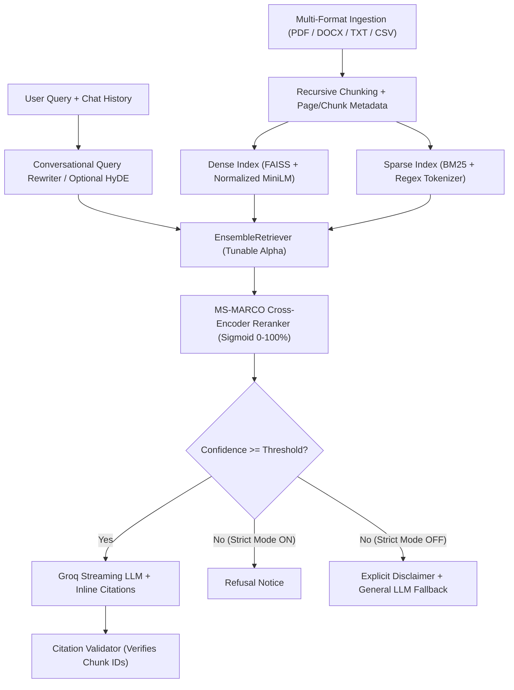

# ⚡ VeriDoc AI — Enterprise Hybrid RAG & Document Intelligence Platform

**VeriDoc AI** is a production-grade Retrieval-Augmented Generation (RAG) engine built for multi-document enterprise knowledge retrieval. It combines **Dense Vector Search (FAISS)**, **Sparse Lexical Search (BM25)**, **MS-MARCO Cross-Encoder Re-Ranking**, **Conversational Query Rewriting**, and **Strict Citation Validation** inside an interactive **Streamlit** dashboard.

> 🚀 **Live Demo:** **[veridoc-rag-ahemad.streamlit.app](https://veridoc-rag-ahemad.streamlit.app/)**

---

## 🎯 Problem Statement

Standard "naive" vector RAG pipelines frequently fail on enterprise documentation (compliance standards, technical specs, financial reports) due to:
1. **Exact-Term Misses:** Dense embeddings alone struggle with exact identifiers, protocol versions (`TLS 1.3`, `PKCE`), and numeric thresholds (`99.99%`, `200ms`).
2. **Context Noise & Hallucinations:** Unfiltered vector retrieval passes distractor chunks into the LLM context window.
3. **No Out-of-Domain Guardrails:** Basic RAG apps force-fit irrelevant chunks when asked off-topic questions.

**VeriDoc AI** solves these with a tunable Hybrid + Re-Ranking pipeline, sigmoid confidence gating, and automated citation verification.

---

## 🏗️ System Architecture



---

## ✨ Key Engineering Features

- **Modular Codebase:** Cleanly separated into `ingest.py`, `retrieval.py`, `storage.py`, `eval_suite.py`, and `app.py`.
- **Hybrid Retrieval + Custom BM25:** Combines normalized `all-MiniLM-L6-v2` FAISS vectors with a case- and punctuation-insensitive regex BM25 tokenizer.
- **Cross-Encoder Re-Ranking & Confidence Gate:** Converts raw MS-MARCO logits via sigmoid into `0–100%` confidence scores and filters out low-relevance distractors.
- **Hallucination & Citation Guardrails:** Enforces `NOT_FOUND` sentinel fallback, Strict Document-Only mode, and post-generation citation ID validation.
- **Session-Namespaced Persistence:** Saves FAISS indexes, document chunks, and chat history to disk across page refreshes, with per-document deletion and Markdown export.
- **Built-In Observability & Evaluation:** Includes a **Retrieval Inspector** tab (BM25 vs. FAISS vs. Reranked) and an **Accuracy & Eval** benchmark tab.

---

## 📊 Verified Evaluation Benchmark

Evaluated on the 7-case enterprise benchmark (`eval_suite.py` using `qwen/qwen3.8-27b`, 50% FAISS / 50% BM25, Cross-Encoder ON):

| Metric | Score | Notes |
| :--- | :---: | :--- |
| **Retrieval Hit Rate@K** | **100.0%** | 5/5 in-domain queries retrieved the target chunk at **Rank #1** |
| **Mean Reciprocal Rank (MRR)** | **1.00** | Top-ranked chunk matched every in-domain ground-truth query |
| **Faithfulness** | **100.0%** | Zero unsupported/hallucinated claims across all in-domain answers |
| **Off-Topic Rejection Rate** | **100.0%** | 2/2 off-topic queries scored `0.0%` confidence and triggered fallback |
| **Answer Correctness (Strict Judge)** | **68.6%** | Scored against full multi-fact reference strings |

---

## 🚀 Local Setup & Deployment

### 1. Run Locally
```bash
git clone https://github.com/<your-username>/veridoc-hybrid-rag.git
cd veridoc-hybrid-rag
pip install -r requirements.txt
```
Create a `.env` file:
```env
GROQ_API_KEY=your_groq_api_key_here
```
Launch the app:
```bash
streamlit run app.py
```

### 2. Deploy on Streamlit Community Cloud (Free)
1. Push this repository to GitHub (`.env` and `.veridoc_storage/` are excluded via `.gitignore`).
2. Go to [share.streamlit.io](https://share.streamlit.io) → **Create app** → select `app.py`.
3. Add `GROQ_API_KEY = "your_key"` under **Advanced settings → Secrets** and click **Deploy**.
