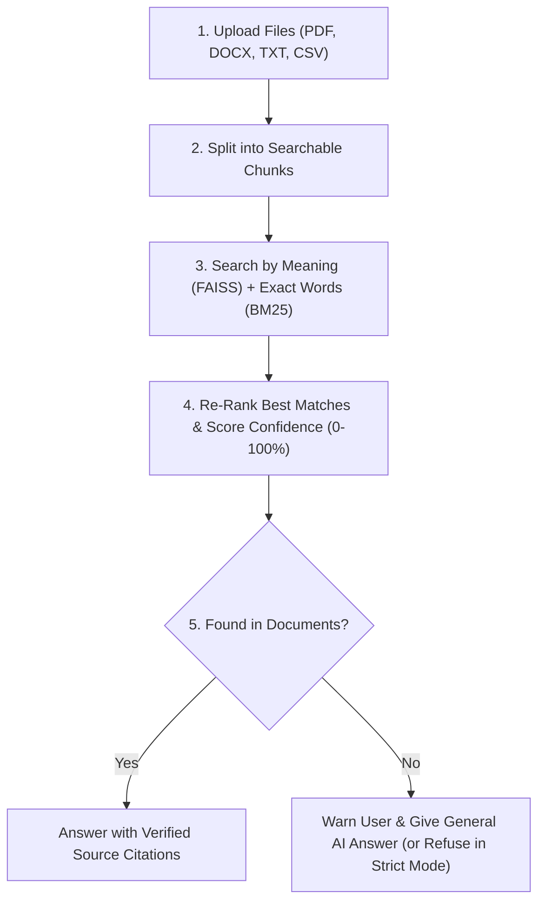

# ⚡ VeriDoc AI — Smart Document Q&A Assistant

**VeriDoc AI** lets you upload PDFs, Word documents, text files, or spreadsheets and ask questions in plain English—getting **fast, accurate answers with exact source references** so you know where every fact came from.

> 🚀 **Try the Live App:** **[veridoc-rag-ahemad.streamlit.app](https://veridoc-rag-ahemad.streamlit.app/)**

---

## 💡 Why I Built This (The Problem)

Reading through 50–100 page company policies, contracts, or technical manuals to find one specific answer takes too much time. On the other hand, pasting entire files into a normal AI chatbot often leads to:
- **Made-up answers (hallucinations)** when the AI guesses instead of checking the file.
- **Missed details** like exact numbers, codes, or policy rules.
- **No proof** of which page or paragraph an answer came from.

**VeriDoc AI** solves this by searching your documents **two ways at once** (by meaning *and* by exact keywords), double-checking the best paragraphs before answering, and showing you the exact source snippets with a confidence score.

---

## ⚙️ How It Works (In Simple Steps)



---

## ✨ Key Features

- **Multi-Format Upload:** Works with `.pdf`, `.docx`, `.txt`, and `.csv` files (plus a 1-click **Load Demo Enterprise Doc** button).
- **Two-Way Smart Search:** Combines semantic search (understands what you mean) with keyword search (catches exact terms like `TLS 1.3` or `99.99%`).
- **Confidence Check & Source Cards:** Every answer shows the exact document snippets used and a `0–100%` confidence score.
- **Honest Off-Topic Handling:** If your question isn't covered in the uploaded files, the app clearly warns you before giving a general AI answer—or refuses if **Strict Document-Only Mode** is turned on.
- **Saves Your Session:** Uploaded files and chat history stay saved even if you refresh the page, with options to delete individual files or export your chat as Markdown.
- **Built-In Transparency Tabs:** Includes a **Retrieval Inspector** (compare keyword vs. meaning search side by side) and an **Accuracy & Eval** tab to test accuracy live.

---

## 📊 Tested Accuracy (7-Case Benchmark)

Evaluated using the built-in test suite (`eval_suite.py`):

| What Was Tested | Result | What It Means |
| :--- | :---: | :--- |
| **Finding the Right Paragraph** | **100.0%** | Found the exact right section on the first try for every test question |
| **No Made-Up Facts (Faithfulness)** | **100.0%** | Every answer stuck strictly to what was written in the document |
| **Catching Unrelated Questions** | **100.0%** | Correctly flagged off-topic questions instead of faking a source |
| **Overall Answer Completeness** | **68.6%** | Graded strictly against full multi-part reference answers |

---

## 🛠️ Project Structure

- `app.py` — Main Streamlit web app and user interface
- `ingest.py` — Reads PDF, Word, text, and CSV files into clean chunks
- `retrieval.py` — Two-way search (FAISS + BM25), re-ranking, and citation checks
- `storage.py` — Saves your uploaded index and chat history across refreshes
- `eval_suite.py` — Automated accuracy test suite

---

## 🚀 Run It Yourself

```bash
git clone https://github.com/ahemadraza31/veridoc-hybrid-rag.git
cd veridoc-hybrid-rag
pip install -r requirements.txt
```

Create a `.env` file with your Groq API key:
```env
GROQ_API_KEY=your_groq_api_key_here
```

Start the app:
```bash
streamlit run app.py
```
